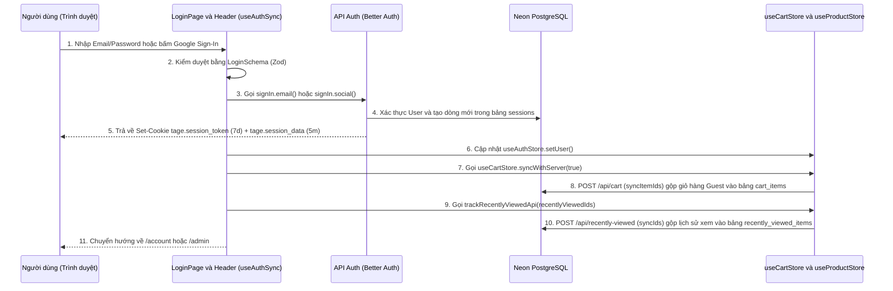

# Luồng 01: Xác Thực Người Dùng, Cơ Chế Dual-Token & Đồng Bộ Client (`Better Auth`)

Tài liệu này giải thích chi tiết luồng đăng nhập, đăng ký, cơ chế **Access Token + Refresh Token**, phân quyền Admin và đồng bộ dữ liệu giữa khách vãng lai (Guest) với tài khoản thực tế đã được triển khai trong code.

---

## 1. Các File Tham Gia Trong Luồng

| Tầng | File | Vai trò |
| :--- | :--- | :--- |
| **Server Core** | [`src/server/auth/auth.ts`](../../src/server/auth/auth.ts) | Cấu hình trung tâm Better Auth, Prisma Adapter, Cookie Cache (Access Token) & DB Session (Refresh Token), Google OAuth, 2FA. |
| **Server Session** | [`src/server/auth/session.ts`](../../src/server/auth/session.ts) | Cung cấp `getSession()` (đọc nhanh qua Cookie Cache) và `getFreshSession()` (bỏ qua cache, kiểm tra trực tiếp DB). |
| **Server Guards** | [`src/server/auth/guards.ts`](../../src/server/auth/guards.ts) | Cung cấp `requireUser()` và `requireAdmin()` chặn truy cập trái phép tại Server Actions / API. |
| **Edge Middleware** | [`src/middleware.ts`](../../src/middleware.ts) | Kiểm tra sự tồn tại của cookie `tage.session_token` trước khi cho phép vào bất kỳ route `/admin/*` nào. |
| **API Route** | [`src/app/api/auth/[...all]/route.ts`](../../src/app/api/auth/%5B...all%5D/route.ts) | Catch-all endpoint xử lý toàn bộ HTTP request `/api/auth/*` (đăng nhập, đăng ký, OAuth callback, làm mới phiên). |
| **Client SDK** | [`src/lib/auth-client.ts`](../../src/lib/auth-client.ts) | Khởi tạo `authClient` (`signIn`, `signUp`, `signOut`, `useSession`) phía trình duyệt. |
| **Client Sync Hook** | [`src/hooks/useAuthSync.ts`](../../src/hooks/useAuthSync.ts) | Tự động đồng bộ phiên từ `useSession()` sang `useAuthStore`, đồng thời gộp giỏ hàng và lịch sử xem sản phẩm lên DB. |
| **Zustand Store** | [`src/service/auth/store.ts`](../../src/service/auth/store.ts) | Lưu trữ thông tin `user` phía Client để hiển thị tức thì trên Header, Account Page và Admin Studio. |
| **UI Pages** | [`src/app/auth/login/page.tsx`](../../src/app/auth/login/page.tsx)<br>[`src/app/auth/register/page.tsx`](../../src/app/auth/register/page.tsx)<br>[`src/app/(shop)/account/page.tsx`](../../src/app/(shop)/account/page.tsx) | Giao diện Đăng nhập, Đăng ký và Quản lý tài khoản. |

---

## 2. Cơ Chế Dual-Token (Access Token + Refresh Token) Hoạt Động Như Thế Nào?

Trong [`src/server/auth/auth.ts`](../../src/server/auth/auth.ts), hệ thống sử dụng cơ chế **Dual-Token Cookie** kết hợp với cơ sở dữ liệu PostgreSQL:

```text
┌────────────────────────────────────────────────────────────────────────────┐
│ 1. ACCESS TOKEN (Cookie: tage.session_data)                                │
│    - Định dạng: Payload phiên đã được ký HMAC-SHA256 bằng BETTER_AUTH_SECRET│
│    - Thời hạn (maxAge): 5 phút (300 giây)                                  │
│    - Tác dụng: Khi các API (/api/cart, /api/recently-viewed) gọi           │
│      getSession(), Server giải mã chữ ký ngay trên RAM mà KHÔNG cần query  │
│      xuống bảng sessions trong DB -> tốc độ phản hồi cực nhanh.            │
├────────────────────────────────────────────────────────────────────────────┤
│ 2. REFRESH TOKEN (Cookie: tage.session_token + Bảng PostgreSQL `sessions`) │
│    - Định dạng: Chuỗi token ngẫu nhiên gắn với bản ghi trong bảng sessions │
│    - Thời hạn (expiresIn): 7 ngày (604.800 giây)                           │
│    - Cơ chế làm mới:                                                       │
│      + Khi Access Token (5 phút) hết hạn, Better Auth tự động dùng         │
│        tage.session_token đối chiếu bảng sessions trong DB để kiểm tra     │
│        phiên có bị thu hồi (revoke) hay chưa, sau đó cấp lại               │
│        tage.session_data (Access Token) mới.                               │
│      + Cứ mỗi 24 giờ (updateAge: 86400), thời hạn của Refresh Token trong  │
│        DB được tự động gia hạn thêm (Sliding Window Rotation).             │
│      + Đối với các tác vụ nhạy cảm của Admin (requireAdmin), hệ thống gọi  │
│        getFreshSession() (disableCookieCache: true) để bắt buộc kiểm tra   │
│        trực tiếp vào bảng sessions trong DB.                               │
├────────────────────────────────────────────────────────────────────────────┤
│ 3. GOOGLE OAUTH REFRESH TOKEN (Bảng PostgreSQL `accounts`)                 │
│    - Cấu hình: accessType: "offline", prompt: "select_account consent"     │
│    - Lưu đầy đủ accessToken và refreshToken của Google vào bảng accounts.  │
└────────────────────────────────────────────────────────────────────────────┘
```

---

## 3. Sơ Đồ Luồng Đăng Nhập & Đồng Bộ Dữ Liệu (Guest -> Logged-in User)



---

## 4. Luồng Bảo Vệ Trang Quản Trị (`/admin/*`)

Hệ thống bảo vệ khu vực Admin qua **3 lớp (Defense-in-Depth)**:
1. **Lớp 1 — Edge Middleware ([`src/middleware.ts`](../../src/middleware.ts))**:
   - Chặn ngay tại biên: Nếu request vào `/admin/*` không có cookie `tage.session_token`, tự động redirect về `/auth/login?redirect=/admin&reason=admin_required`.
2. **Lớp 2 — Client Layout Guard ([`src/app/admin/layout.tsx`](../../src/app/admin/layout.tsx))**:
   - Gọi hook `useAuthSync()` để lấy phiên thực tế từ Better Auth. Nếu `user.role` không phải `"admin"`, lập tức đẩy về trang đăng nhập.
3. **Lớp 3 — Server Action Guard ([`src/server/auth/guards.ts`](../../src/server/auth/guards.ts))**:
   - Mọi hàm thay đổi dữ liệu trong [`src/service/products/actions.ts`](../../src/service/products/actions.ts) đều gọi `await requireAdmin()` ở dòng đầu tiên. Hàm này gọi `getFreshSession()` kiểm tra trực tiếp xuống PostgreSQL xem phiên còn hiệu lực và `user.role === "admin"` hay không trước khi cho phép ghi DB.
