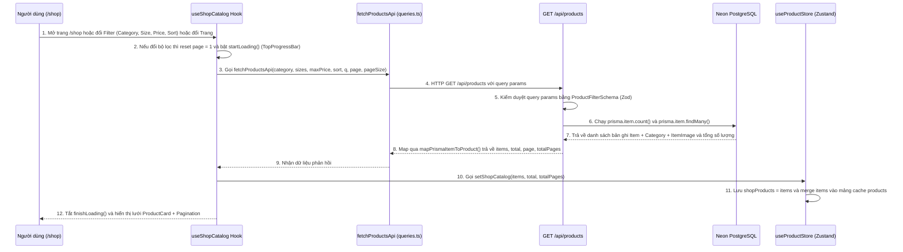

# Luồng 02: Trang Chủ (`/`), Danh Sách Sản Phẩm (`/shop`), Bộ Lọc & Phân Trang

Tài liệu này mô tả chi tiết luồng hiển thị Trang chủ, cơ chế gọi API lấy danh sách sản phẩm tại `/shop`, lọc trên toàn bộ cơ sở dữ liệu, phân trang và cơ chế lưu trữ vào Zustand Store (`useProductStore`).

---

## 1. Các File Tham Gia Trong Luồng

| Tầng | File | Vai trò |
| :--- | :--- | :--- |
| **Route Pages** | [`src/app/(shop)/page.tsx`](../../src/app/%28shop%29/page.tsx) [`src/app/(shop)/shop/page.tsx`](../../src/app/%28shop%29/shop/page.tsx) | Giao diện Trang chủ (`/`) và Trang danh sách sản phẩm (`/shop`). |
| **UI Components** | [`src/components/home/*`](../../src/components/home/) [`src/components/product/ShopHeader.tsx`](../../src/components/product/ShopHeader.tsx) [`src/components/product/FilterDrawer.tsx`](../../src/components/product/FilterDrawer.tsx) [`src/components/product/ProductCard.tsx`](../../src/components/product/ProductCard.tsx) [`src/components/ui/Pagination.tsx`](../../src/components/ui/Pagination.tsx) | Các khối hiển thị banner trang chủ, thanh chọn danh mục, ngăn kéo bộ lọc, thẻ sản phẩm (hỗ trợ vuốt ngang xem ảnh trên điện thoại) và thanh phân trang. |
| **Custom Hooks** | [`src/hooks/useShopCatalog.ts`](../../src/hooks/useShopCatalog.ts) [`src/hooks/usePagination.ts`](../../src/hooks/usePagination.ts) | Điều phối state bộ lọc, trang hiện tại, gọi API `/api/products` và cập nhật Zustand Store. |
| **Service & Store** | [`src/service/products/queries.ts`](../../src/service/products/queries.ts) [`src/service/products/store.ts`](../../src/service/products/store.ts) [`src/service/products/schema.ts`](../../src/service/products/schema.ts) | Hàm `fetchProductsApi()` gọi HTTP GET, kiểm duyệt bằng `ProductFilterSchema`, và lưu vào `useProductStore`. |
| **API Route** | [`src/app/api/products/route.ts`](../../src/app/api/products/route.ts) | Endpoint `GET /api/products` thực thi truy vấn `prisma.item.findMany()` và `prisma.item.count()` trên PostgreSQL. |

---

## 2. Luồng Trang Chủ (`/`)

1. Trang chủ ([`src/app/(shop)/page.tsx`](../../src/app/%28shop%29/page.tsx)) được chia thành các component dùng chung gọn gàng trong `src/components/home/`:
   - [`HomeVideoBanner.tsx`](../../src/components/home/HomeVideoBanner.tsx): Phát video nền tự động (`autoPlay`, `muted`, `loop`, `playsInline`) kèm lớp phủ fallback an toàn.
   - [`HomeNavStrip.tsx`](../../src/components/home/HomeNavStrip.tsx): Thanh điều hướng nhanh sang các danh mục thực tế (`/shop?category=Top`, `Bottom`, `Outerwear`, `New+Arrivals`).
   - [`HomeEditorialTile.tsx`](../../src/components/home/HomeEditorialTile.tsx): Các khối hình ảnh chiến dịch (`Top`, `Bottom`, `Outerwear`, `New Arrivals`) sử dụng class `.rv` kết hợp `IntersectionObserver` (khởi tạo trong [`Header.tsx`](../../src/components/layout/Header.tsx)) để tạo hiệu ứng chữ chạy mượt mà từ dưới lên khi người dùng cuộn trang tới.
   - [`HomeStoreInfoSection.tsx`](../../src/components/home/HomeStoreInfoSection.tsx): Thông tin cửa hàng vật lý TAGE và form đăng ký nhận tin.
2. Khi người dùng bấm vào bất kỳ danh mục nào trên Trang chủ, trình duyệt điều hướng sang `/shop?category=...`, kích hoạt luồng tải dữ liệu từ API.

---

## 3. Luồng Danh Sách Sản Phẩm (`/shop`), Lọc (Filter) & Phân Trang (Pagination)

### Tại sao cả Filter và Pagination đều bắt buộc gọi API?
Do mỗi trang chỉ tải `pageSize = 9` sản phẩm từ server, nếu thực hiện filter ở phía client thì chỉ lọc được trong 9 sản phẩm của trang đang đứng. Vì vậy, mọi thao tác **chọn Category, chọn Size, kéo thanh Giá tối đa (`maxPrice`), đổi Sắp xếp (`sort`), Tìm kiếm (`q`) hoặc chuyển Trang (`page`)** đều gọi xuống `GET /api/products` để lọc trên **toàn bộ cơ sở dữ liệu PostgreSQL**.

### Sơ Đồ Luồng Hoạt Động:

---

## 4. Chiến Lược Lưu Trữ Zustand Store Khi Phân Trang (`setShopCatalog`)

Trong [`src/service/products/store.ts`](../../src/service/products/store.ts), khi nhận dữ liệu từ API phân trang, hàm `setShopCatalog(items, total, totalPages)` thực hiện **2 việc song song**:

1. **Cập nhật State hiển thị của trang hiện tại (`shopProducts`, `shopTotal`, `shopTotalPages`)**:
   - Đảm bảo lưới sản phẩm tại `/shop` luôn hiển thị đúng các sản phẩm của trang `page` và bộ lọc hiện tại mà không bị lẫn lộn với trang trước.
2. **Gộp (Upsert/Merge) các sản phẩm vừa tải vào bộ nhớ đệm `products` trong Store**:
   - Mỗi sản phẩm tải về từ trang 1, trang 2, trang 3... đều được cập nhật vào mảng `products` chung của store.
   - **Lợi ích**: Khi người dùng bấm từ trang danh sách `/shop` vào trang chi tiết `/product/[slug]`, hệ thống tìm thấy ngay dữ liệu cơ bản của sản phẩm trong cache `useProductStore.products` để hiển thị tức thì (0ms delay) trong lúc chờ API chi tiết `/api/products/[slug]` tải thêm dữ liệu phối đồ (`comboItems`).
