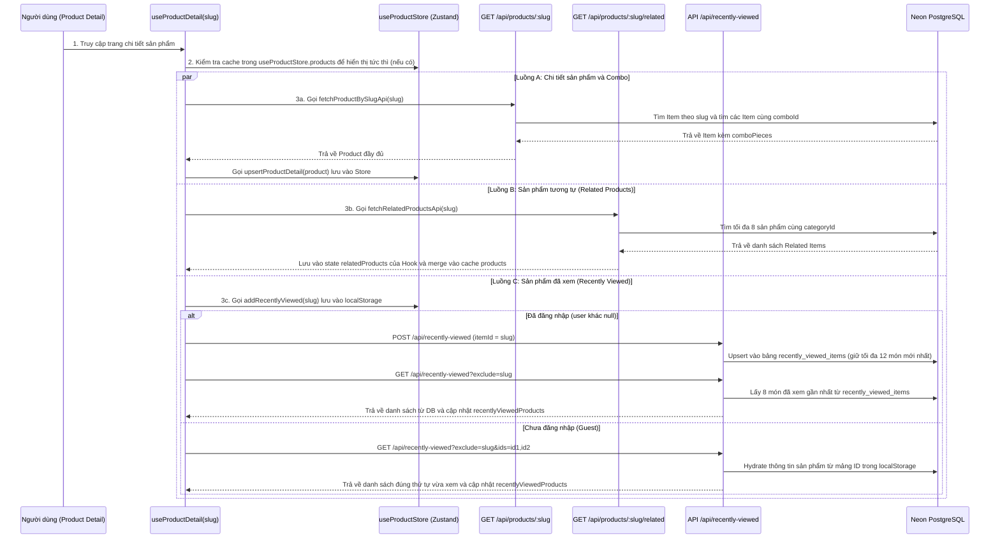

# Luồng 03: Trang Chi Tiết Sản Phẩm (`/product/[slug]`), Sản Phẩm Tương Tự & Sản Phẩm Đã Xem

Tài liệu này giải thích chi tiết luồng hoạt động khi người dùng truy cập trang Chi tiết sản phẩm (`/product/[slug]`), nơi điều phối đồng thời **3 luồng API**:
1. **API Chi tiết sản phẩm & Phối đồ (`GET /api/products/[slug]`)**
2. **API Sản phẩm tương tự (`GET /api/products/[slug]/related`)**
3. **API Danh sách sản phẩm đã xem (`GET & POST /api/recently-viewed`)**

---

## 1. Các File Tham Gia Trong Luồng

| Tầng | File | Vai trò |
| :--- | :--- | :--- |
| **Route Page** | [`src/app/(shop)/product/[slug]/page.tsx`](../../src/app/%28shop%29/product/%5Bslug%5D/page.tsx) | Trang chi tiết sản phẩm, gọi `useProductDetail(slug)` và lắp ghép `ProductGallery`, `ProductInfo`, `ProductCarousel`. |
| **UI Components** | [`src/components/product/ProductGallery.tsx`](../../src/components/product/ProductGallery.tsx) [`src/components/product/ProductInfo.tsx`](../../src/components/product/ProductInfo.tsx) [`src/components/product/ProductComboLook.tsx`](../../src/components/product/ProductComboLook.tsx) [`src/components/product/ProductCarousel.tsx`](../../src/components/product/ProductCarousel.tsx) | Hiển thị bộ ảnh (kèm zoom modal), thông tin giá/size/tình trạng, khối "Shop the Look" (`comboItems`), và 2 băng chuyền "Related Products" & "Recently Viewed". |
| **Custom Hook** | [`src/hooks/useProductDetail.ts`](../../src/hooks/useProductDetail.ts) | Hook trung tâm điều phối cả 3 API, cập nhật Zustand Store và xử lý phân nhánh User vs Guest cho danh sách đã xem. |
| **Service & Store** | [`src/service/products/queries.ts`](../../src/service/products/queries.ts) [`src/service/products/store.ts`](../../src/service/products/store.ts) | Chứa `fetchProductBySlugApi`, `fetchRelatedProductsApi`, `fetchRecentlyViewedApi`, `trackRecentlyViewedApi` và các action cập nhật store. |
| **API Routes** | [`src/app/api/products/[slug]/route.ts`](../../src/app/api/products/%5Bslug%5D/route.ts) [`src/app/api/products/[slug]/related/route.ts`](../../src/app/api/products/%5Bslug%5D/related/route.ts) [`src/app/api/recently-viewed/route.ts`](../../src/app/api/recently-viewed/route.ts) | 3 Route Handlers truy vấn trực tiếp từ PostgreSQL qua Prisma. |

---

## 2. Sơ Đồ Tổng Thể 3 Luồng API Tại Trang Chi Tiết Sản Phẩm

---

## 3. Giải Thích Các Quyết Định Kiến Trúc Trong Luồng Này

### 3.1. Lưu Chi Tiết Sản Phẩm Vào Store (`upsertProductDetail`)
- Khi `GET /api/products/[slug]` trả về đối tượng `Product` hoàn chỉnh (bao gồm cả mô tả chi tiết, ảnh tạm `temporaryImages`, và danh sách phối đồ `comboItems`), hook gọi `upsertProductDetail(product)` trong [`useProductStore`](../../src/service/products/store.ts).
- Nếu sản phẩm đã có trong mảng `products` (do đã tải từ trang `/shop` trước đó), bản ghi trong store được nâng cấp thêm đầy đủ trường `comboItems`; nếu chưa có (do người dùng vào thẳng link `/product/[slug]`), sản phẩm được thêm mới vào store.

### 3.2. Tại Sao `relatedProducts` Được Lưu Ở State Của Hook Mà Không Ghi Đè Danh Sách Chính Trong Store?
- Danh sách **Sản phẩm tương tự (`relatedProducts`)** phụ thuộc chặt chẽ vào ngữ cảnh của từng `slug` cụ thể đang mở.
- Theo chuẩn kiến trúc Frontend:
  1. Danh sách hiển thị của carousel "Related Products" được giữ trong local state `relatedProducts` của hook [`useProductDetail`](../../src/hooks/useProductDetail.ts) để không làm hỏng danh sách `shopProducts` khi người dùng bấm nút Back quay lại trang `/shop`.
  2. Tuy nhiên, dữ liệu của các sản phẩm tương tự đó vẫn được truyền qua `upsertProductsToCache(res.data)` để làm giàu bộ nhớ đệm `products` trong Zustand Store. Nhờ vậy, nếu người dùng bấm vào một sản phẩm trong mục "Related Products", trang mới sẽ mở ra tức thì từ cache!

### 3.3. Cơ Chế Phân Nhánh "Sản Phẩm Đã Xem" (Database vs `localStorage`)
- **Khi người dùng ĐÃ ĐĂNG NHẬP (`user !== null`)**:
  - Hook gọi `POST /api/recently-viewed` với `{ itemId: slug }`. Server thực hiện `prisma.recentlyViewed.upsert` theo khóa phức hợp `userId_itemId` (nếu đã xem trước đó thì cập nhật lại `viewedAt = new Date()`), đồng thời tự động cắt gọn chỉ giữ tối đa 12 sản phẩm gần nhất cho mỗi user để tối ưu dung lượng DB.
  - Sau đó gọi `GET /api/recently-viewed?exclude=[slug]` để lấy danh sách sản phẩm đã xem trực tiếp từ bảng `recently_viewed_items` trong PostgreSQL.
- **Khi người dùng CHƯA ĐĂNG NHẬP (`user === null`)**:
  - Danh sách ID/slug sản phẩm vừa xem được lưu trong `localStorage` thông qua `useProductStore.recentlyViewedIds`.
  - Hook hiển thị ngay các sản phẩm có sẵn trong store cache, đồng thời gọi `GET /api/recently-viewed?exclude=[slug]&ids=...` để lấy thông tin mới nhất (giá, trạng thái còn hàng/đã bán) từ DB theo đúng thứ tự xem của khách.
- **Khi khách chuyển sang Đăng nhập**:
  - Hook [`useAuthSync`](../../src/hooks/useAuthSync.ts) tự động gửi toàn bộ `recentlyViewedIds` từ `localStorage` lên `POST /api/recently-viewed` (`syncIds`) để đồng bộ lịch sử xem vào tài khoản của user.
