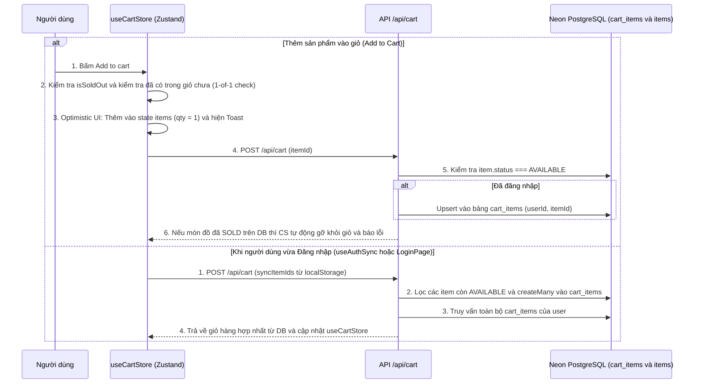

# Luồng 04: Hệ Thống Giỏ Hàng Độc Bản (1-of-1) & Đặt Hàng Qua Instagram Direct

Tài liệu này mô tả chi tiết thiết kế API giỏ hàng tối ưu cho đặc thù **đồ second-hand / archive mỗi mẫu chỉ có duy nhất 1 chiếc (`1-of-1`)** và luồng đặt hàng qua **Instagram Direct Concierge** tại `/cart`, `/checkout`, và `/checkout/success`.

---

## 1. Các File Tham Gia Trong Luồng

| Tầng | File | Vai trò |
| :--- | :--- | :--- |
| **Route Pages** | [`src/app/(shop)/cart/page.tsx`](../../src/app/%28shop%29/cart/page.tsx)<br>[`src/app/(shop)/checkout/page.tsx`](../../src/app/%28shop%29/checkout/page.tsx)<br>[`src/app/(shop)/checkout/success/page.tsx`](../../src/app/%28shop%29/checkout/success/page.tsx) | Trang Giỏ hàng, Trang điền thông tin giao hàng, và Trang xác nhận kèm tin nhắn Instagram. |
| **UI Components** | [`src/components/cart/CartItemRow.tsx`](../../src/components/cart/CartItemRow.tsx)<br>[`src/components/cart/CartSummary.tsx`](../../src/components/cart/CartSummary.tsx)<br>[`src/components/checkout/CheckoutForm.tsx`](../../src/components/checkout/CheckoutForm.tsx)<br>[`src/components/checkout/OrderSummaryAside.tsx`](../../src/components/checkout/OrderSummaryAside.tsx) | Hiển thị từng món đồ trong giỏ (không có nút tăng/giảm số lượng vì mỗi món chỉ có 1 chiếc), tóm tắt đơn hàng, mã giảm giá `TAGE10` và form địa chỉ nhận hàng. |
| **Custom Hooks** | [`src/hooks/useCart.ts`](../../src/hooks/useCart.ts)<br>[`src/hooks/useCheckout.ts`](../../src/hooks/useCheckout.ts) | Tính toán tiền hàng, giảm giá, phí vận chuyển cố định (\$35), kiểm duyệt Zod và tạo tin nhắn đặt hàng Instagram. |
| **Service & Store** | [`src/service/cart/store.ts`](../../src/service/cart/store.ts)<br>[`src/service/cart/actions.ts`](../../src/service/cart/actions.ts)<br>[`src/service/orders/service.ts`](../../src/service/orders/service.ts)<br>[`src/config/utils.ts`](../../src/config/utils.ts) | Quản lý state giỏ hàng (`useCartStore`), gọi API `/api/cart`, lưu đơn tham chiếu (`useOrderStore`), và hàm `generateInstagramOrderMessage()`. |
| **API Route** | [`src/app/api/cart/route.ts`](../../src/app/api/cart/route.ts) | Endpoint `GET`, `POST`, `DELETE /api/cart` làm việc với bảng `cart_items` và `items` trong PostgreSQL. |

---

## 2. Thiết Kế Giỏ Hàng Tối Ưu Cho Domain Đồ 2Hand Độc Bản (1-of-1)

### 2.1. Đặc thù nghiệp vụ (Domain Constraints)
Khác với thương mại điện tử đại trà (nơi một mẫu áo có hàng trăm chiếc để cộng dồn `qty: 1, 2, 3...`), tại **TAGE**, mỗi sản phẩm (`Item`) là một món đồ vintage/archive **độc bản (`1-of-1`)**:
- Số lượng tối đa của mỗi sản phẩm luôn là **`1`**.
- Trạng thái sản phẩm chỉ có `AVAILABLE` (còn hàng) hoặc `SOLD` (đã bán).

### 2.2. Thiết kế Bảng `cart_items` & API `/api/cart`
1. **Bảng `CartItem` (`cart_items`) trong [`prisma/schema.prisma`](../../prisma/schema.prisma)**:
   - Chỉ gồm: `id`, `userId`, `itemId`, `createdAt` và khóa duy nhất `@@unique([userId, itemId])`.
   - **Không cần cột `quantity`** (tránh dư thừa dữ liệu và loại bỏ hoàn toàn lỗi race-condition đặt lố số lượng tồn kho).
2. **Kiểm tra trùng lặp ngay trên Store ([`src/service/cart/store.ts`](../../src/service/cart/store.ts))**:
   - Khi người dùng bấm **"Add to cart"** trên `ProductCard` hoặc `ProductInfo`:
     - Nếu sản phẩm đã có trạng thái `isSoldOut` -> Báo `"This piece is sold out"` và chặn ngay.
     - Nếu sản phẩm đã nằm trong giỏ hàng (`items.some(i => i.product.id === product.id)`) -> Không cộng dồn số lượng lên 2 mà hiển thị thông báo `"Already in your bag (only 1 piece available)"`.
     - Nếu hợp lệ -> Thêm vào `useCartStore` với `qty: 1` (Optimistic UI giúp hiệu ứng bay vào giỏ `flyToCart` và số đếm trên Header nhảy ngay lập tức), đồng thời gọi ngầm `addCartItemApi(String(product.id))` xuống `/api/cart`.
3. **Tự động làm sạch giỏ hàng (`Auto-Pruning Sold Items`)**:
   - Khi gọi `GET /api/cart`, nếu một món đồ trong giỏ của user vừa bị người khác mua mất (trạng thái trong bảng `items` chuyển sang `SOLD`), API `/api/cart` sẽ **tự động xóa bản ghi đó khỏi `cart_items`** và chỉ trả về các món còn `AVAILABLE`.

### 2.3. Sơ Đồ Luồng Đồng Bộ Giỏ Hàng (Guest vs Logged-in User)



---

## 3. Luồng Đặt Hàng Qua Instagram Direct (`/cart` -> `/checkout` -> `/checkout/success`)

Trong giai đoạn **MVP**, hệ thống không gọi cổng thanh toán tự động mà chuyển toàn bộ thông tin đơn hàng sang cuộc trò chuyện trực tiếp với đội ngũ tư vấn tại **Instagram (`@tage.studio`)**. Người dùng có **2 cách đặt hàng**:

### Cách 1: Đặt Nhanh Trực Tiếp Từ Giỏ Hàng (`/cart`)
- Tại [`CartSummary.tsx`](../../src/components/cart/CartSummary.tsx), người dùng có thể nhập mã giảm giá (ví dụ `TAGE10` giảm 10%) và bấm nút **"Quick Order via Instagram Direct"**.
- Hệ thống gọi `generateInstagramOrderMessage()` tạo nội dung đơn hàng (gồm tên từng món, mã slug, size, giá, tạm tính, giảm giá, phí ship cố định \$35, tổng cộng), tự động sao chép vào **Clipboard**, hiện thông báo xác nhận và mở tab mới tới `INSTAGRAM_SHOP_URL`.

### Cách 2: Điền Đầy Đủ Thông Tin Giao Hàng Tại `/checkout`
1. Từ `/cart`, người dùng bấm **"Include Delivery Address & Order →"** để sang trang `/checkout`.
2. Tại `/checkout` ([`CheckoutForm.tsx`](../../src/components/checkout/CheckoutForm.tsx) & [`useCheckout.ts`](../../src/hooks/useCheckout.ts)):
   - Nếu người dùng đã đăng nhập, form tự động điền sẵn Email và Họ tên.
   - Người dùng nhập Email, Họ tên, Số điện thoại và Địa chỉ nhận hàng, sau đó bấm **"Confirm & Order via Instagram"**.
3. Hook [`useCheckout`](../../src/hooks/useCheckout.ts) thực hiện:
   - Kiểm duyệt dữ liệu bằng `CheckoutFormSchema` (Zod).
   - Sinh mã đơn hàng tham chiếu duy nhất (ví dụ: `TG-849210`).
   - Gọi `generateInstagramOrderMessage()` trong [`src/config/utils.ts`](../../src/config/utils.ts) tạo bức thư đặt hàng hoàn chỉnh:
     ```text
     Hi TAGE Studio! I would like to order the following 1-of-1 piece(s) [Ref: TG-849210]:

     1. Zip Out Work Jacket (Size: M) [zip-out-work-jacket-1] — $260

     Subtotal: $260
     Discount (TAGE10): -$26
     Shipping: $35
     Total: $269

     — Delivery Information —
     Recipient: Nguyen Van A
     Phone: 0901234567
     Email: a@example.com
     Address: 42 Nguyen Hue, Ho Chi Minh City, Vietnam

     Please confirm piece availability and payment details. Thank you!
     ```
   - Lưu đơn hàng và nội dung tin nhắn vào `useOrderStore` (`addOrder(createdOrder, message)`).
   - Sao chép tin nhắn vào Clipboard (`navigator.clipboard.writeText`), mở Instagram Direct trong tab mới, làm trống giỏ hàng (`clearCart()` — xóa cả trên DB qua `DELETE /api/cart?clearAll=true`), và chuyển hướng sang `/checkout/success?order=TG-849210`.
4. Tại trang [`/checkout/success`](../../src/app/%28shop%29/checkout/success/page.tsx):
   - Hiển thị lại toàn bộ nội dung tin nhắn đơn hàng trong một khung văn bản rõ ràng kèm nút **"Copy Again"** và **"Open Instagram Direct →"** (đề phòng trường hợp trình duyệt điện thoại chặn popup hoặc chặn copy tự động).
