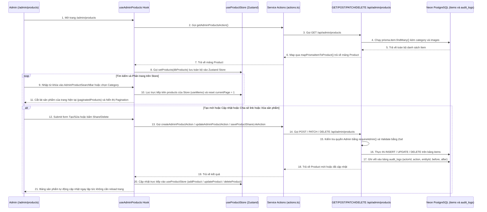

# Luồng 05: Quản Trị Admin Studio (`/admin`), Tìm Kiếm Trên Store & Phân Trang

Tài liệu này mô tả chi tiết luồng hoạt động của khu vực Quản trị viên (**Admin Studio**), bao gồm cơ chế tải danh sách sản phẩm từ PostgreSQL vào Zustand Store, tìm kiếm tức thì trên Store, phân trang và ghi nhận nhật ký kiểm toán (`AuditLog`).

---

## 1. Các File Tham Gia Trong Luồng

| Tầng | File | Vai trò |
| :--- | :--- | :--- |
| **Route Pages** | [`src/app/admin/layout.tsx`](../../src/app/admin/layout.tsx) [`src/app/admin/page.tsx`](../../src/app/admin/page.tsx) [`src/app/admin/products/page.tsx`](../../src/app/admin/products/page.tsx) | Layout bảo vệ Admin, trang Dashboard tổng quan và trang Quản lý Sản phẩm & Tồn kho. |
| **UI Components** | [`src/components/admin/products/AdminProductHeader.tsx`](../../src/components/admin/products/AdminProductHeader.tsx) [`src/components/admin/products/AdminProductSearchBar.tsx`](../../src/components/admin/products/AdminProductSearchBar.tsx) [`src/components/admin/products/AdminProductsTable.tsx`](../../src/components/admin/products/AdminProductsTable.tsx) [`src/components/admin/products/AdminProductCreateModal.tsx`](../../src/components/admin/products/AdminProductCreateModal.tsx) [`src/components/admin/products/AdminProductEditModal.tsx`](../../src/components/admin/products/AdminProductEditModal.tsx) [`src/components/ui/Pagination.tsx`](../../src/components/ui/Pagination.tsx) | Giao diện quản lý danh mục sản phẩm: thanh tìm kiếm tối giản + bộ lọc Category, bảng sản phẩm, modal thêm/sửa sản phẩm và thanh phân trang tái sử dụng. |
| **Custom Hooks** | [`src/hooks/useAdminProducts.ts`](../../src/hooks/useAdminProducts.ts) [`src/hooks/useAdminDashboard.ts`](../../src/hooks/useAdminDashboard.ts) | Quản lý việc nạp danh sách từ API vào `useProductStore`, lọc/tìm kiếm trực tiếp trên Store, phân trang và gọi các hàm CRUD. |
| **Service & Store** | [`src/service/products/actions.ts`](../../src/service/products/actions.ts) [`src/service/products/store.ts`](../../src/service/products/store.ts) [`src/service/products/schema.ts`](../../src/service/products/schema.ts) | Chứa các hàm gọi REST API `/api/admin/products` (`getAdminProductsAction`, `createAdminProductAction`, `updateAdminProductAction`, `updateAdminStockAction`, `saveProductShareLinkAction`, `deleteAdminProductAction`) và Zustand Store `useProductStore`. |
| **API Routes (DB)** | [`src/app/api/admin/products/route.ts`](../../src/app/api/admin/products/route.ts) [`src/app/api/share/[code]/route.ts`](../../src/app/api/share/%5Bcode%5D/route.ts) | Tầng duy nhất tương tác trực tiếp với Prisma PostgreSQL cho Admin CRUD, tạo link chia sẻ và ghi `AuditLog`. |

---

## 2. Sự Khác Biệt Giữa Luồng Sản Phẩm Của Admin (`/admin/products`) Và Khách Hàng (`/shop`)

Dự án áp dụng **2 chiến lược tải dữ liệu khác nhau** phù hợp với đặc thù của từng đối tượng sử dụng:

| Tiêu chí | Trang Khách Hàng (`/shop`) | Trang Quản Trị (`/admin/products`) |
| :--- | :--- | :--- |
| **Cách tải dữ liệu** | Gọi `GET /api/products` **theo từng trang** (`pageSize = 9`) và lọc trực tiếp dưới DB. | Gọi `getAdminProductsAction()` tải toàn bộ danh sách sản phẩm trong kho về lưu vào `useProductStore.products`. |
| **Cơ chế Tìm kiếm & Lọc** | Khi khách lọc hoặc đổi trang -> Gọi lại API `/api/products`. | Khi Admin gõ tìm kiếm (theo tên, SKU, màu sắc) hoặc lọc Category -> **Tìm kiếm trực tiếp trên `useProductStore.products`** với tốc độ phản hồi 0ms. |
| **Cơ chế Phân trang** | Server-side Pagination (`totalPages` trả về từ API). | Client-side Store Pagination (`ITEMS_PER_PAGE = 8` tính trên tập `filteredProducts` từ Store), tái sử dụng chung component `<Pagination />`. |

---

## 3. Sơ Đồ Luồng Quản Lý Sản Phẩm Tại `/admin/products`

---

## 4. Luồng Tạo & Tái Sử Dụng Link Chia Sẻ Sản Phẩm Cho Khách Hàng (`/share/[code]`)

Khi khách hàng nhắn tin hỏi thông tin chi tiết hoặc các sản phẩm tương tự, chủ shop thực hiện luồng **Client Share Studio** như sau:

1. **Tìm kiếm & Mở Modal Share tại `/admin/products`**:
   - Chủ shop tìm kiếm sản phẩm trên thanh `AdminProductSearchBar` và bấm nút **`Share`** (hoặc **`Share ✓`** nếu sản phẩm đã từng tạo link trước đó) trên dòng sản phẩm trong [`AdminProductsTable.tsx`](../../src/components/admin/products/AdminProductsTable.tsx).
2. **Chọn Ảnh Hiển Thị (`Official` + `Temporary/Archive`) trong [`AdminProductShareModal.tsx`](../../src/components/admin/products/AdminProductShareModal.tsx)**:
   - Nếu sản phẩm **đã có link lưu trước đó (`product.shareCode`)**: Modal hiển thị ngay đường dẫn tĩnh `/share/${product.shareCode}` ở đầu khung kèm nút **`Copy Saved Link`** và **`Open Page ↗`**, đồng thời tự động tích chọn lại đúng các bức ảnh đã lưu trong `product.sharedImages`. Chủ shop có thể copy dùng lại ngay mà không cần tạo link mới.
   - Chủ shop có thể chọn/bỏ chọn bất kỳ ảnh nào từ **Zone 1 (Ảnh Web chính thức)** và **Zone 2 (Ảnh tạm / ảnh chi tiết thô trong kho)** theo thứ tự mong muốn, hoặc dán thêm nhanh link ảnh tạm mới rồi bấm **`Create & Copy Share Link`** (hoặc **`Update Selection & Copy Share Link`**).
   - Server Action `saveProductShareLinkAction()` trong [`src/service/products/actions.ts`](../../src/service/products/actions.ts) lưu `shareCode` và mảng `sharedImages` xuống bảng `items` trong PostgreSQL và cập nhật `useProductStore`.
3. **Trang Tĩnh Dành Cho Khách Hàng ([`src/app/(shop)/share/[code]/page.tsx`](../../src/app/%28shop%29/share/%5Bcode%5D/page.tsx))**:
   - Khi khách hàng mở link `/share/[code]`, hook [`useSharedProduct.ts`](../../src/hooks/useSharedProduct.ts) gọi `GET /api/share/[code]` ([`src/app/api/share/[code]/route.ts`](../../src/app/api/share/%5Bcode%5D/route.ts)).
   - Giao diện mang đúng ngôn ngữ thiết kế tối giản của **TAGE**, hiển thị bộ sưu tập ảnh được chủ shop chọn (`sharedImages`), thông tin chi tiết sản phẩm (Tên, Giá, Size, Màu sắc, Tình trạng tồn kho, Mô tả & Chính sách).
   - Khi khách bấm nút **`Contact & Purchase via Instagram →`**, hệ thống tự động tạo tin nhắn đặt hàng kèm tên sản phẩm, size, giá và link `/share/[code]`, sao chép vào Clipboard và chuyển hướng thẳng tới trang Instagram của shop (`https://www.instagram.com/tage.fromthepast/`).
